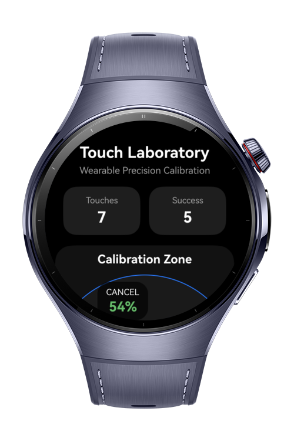
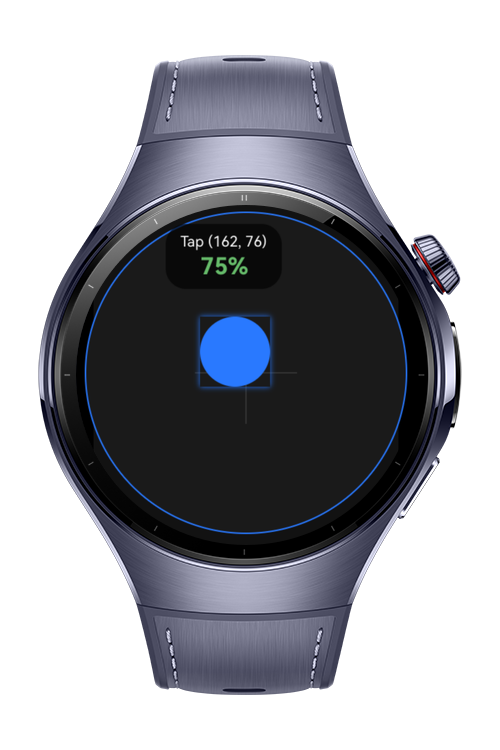
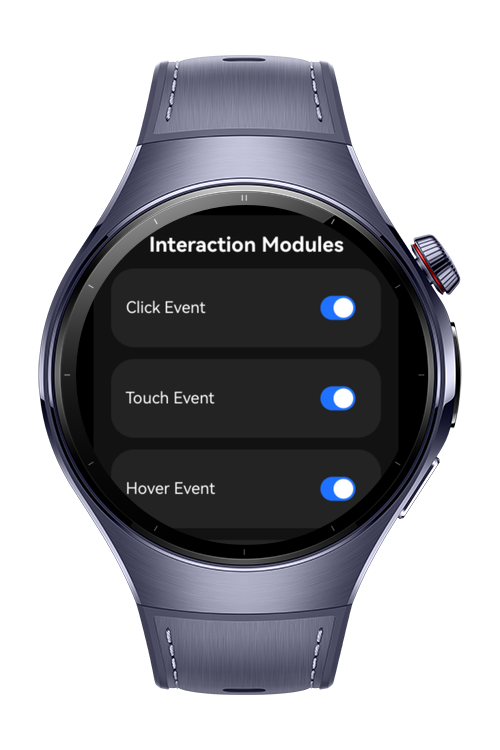
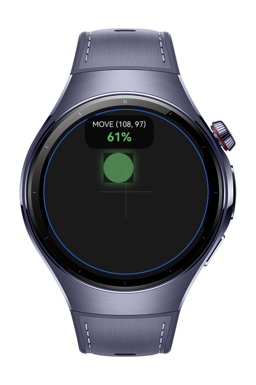

> **Note:** To access all shared projects, get information about environment setup, and view other guides, please visit [Explore-In-HMOS Index](https://github.com/Explore-In-HMOS/hmos-index).

# How To Build Touch Event Handler

A precision touch interaction laboratory designed for HarmonyOS NEXT wearable devices using ArkTS and ArkUI.

This project demonstrates advanced wearable interaction handling including tap callbacks, touch tracking, hover simulation, hit-test behavior, touch target expansion, and click feedback effects on a circular smartwatch interface.

The application acts as an interactive calibration sandbox for analyzing touch accuracy and validating wearable UX behaviors on small round displays.

# Preview

<div>
  
  
  
  

</div>

# Use Cases

- Precision touch calibration for wearable devices
- Tap accuracy analysis on circular smartwatch displays
- ArkUI interaction module demonstrations
- Wearable UX experimentation and prototyping
- Touch coordinate debugging
- Hover behavior simulation
- Hit-test behavior validation
- Gesture lifecycle monitoring
- Touch feedback effect testing
- Educational codelab for ArkTS wearable interactions

# Technology

## Stack

- **Languages**: ArkTS, ArkUI
- **Frameworks**: HarmonyOS SDK 6.0.1 (21)
- **Tools**: DevEco Studio Version 5.1.0.828+
- **Libraries**:
  - `@kit.ArkUI` (UI Components & Layouts)

# Directory Structure

```
ets/
│
├── pages/
│   └── Index.ets
│
├── components/
│   ├── CalibrationTarget.ets
|   ├── CalibrationTarget.ets
│   └── MetricsCard.ets
│
├── common/
│   ├── utils/
│   |   ├── PrecisionUtils.ets
│   |   └── RandomTargetUtils.ets
│   ├── models/
│   |   ├── CalibrationResult.ets
│   |   └── TouchRecord.ets
|   └── constants/
│       └── AppConstants.ets
|
└── entryability/
    └── EntryAbility.ets
```

# Constraints and Restrictions

## Supported Device

* Huawei Watch 4 Series
* Huawei Watch 5 Series
* Circular Screen Wearables (UI optimized via `.clip` and `.width/height` constraints)

# License

**How To Build Touch Event Handler** is distributed under the terms of the MIT License.
See the [LICENSE](./LICENSE) for more information.